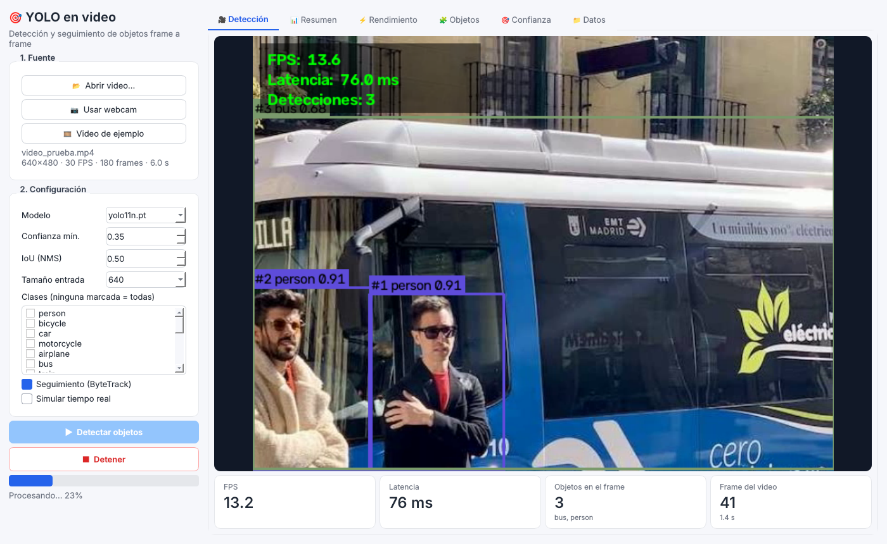
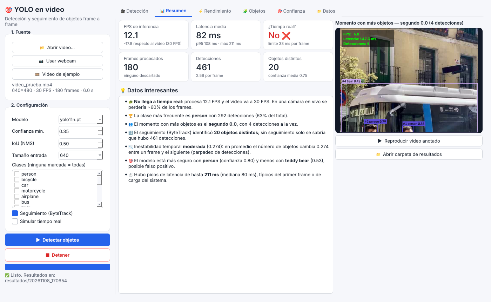
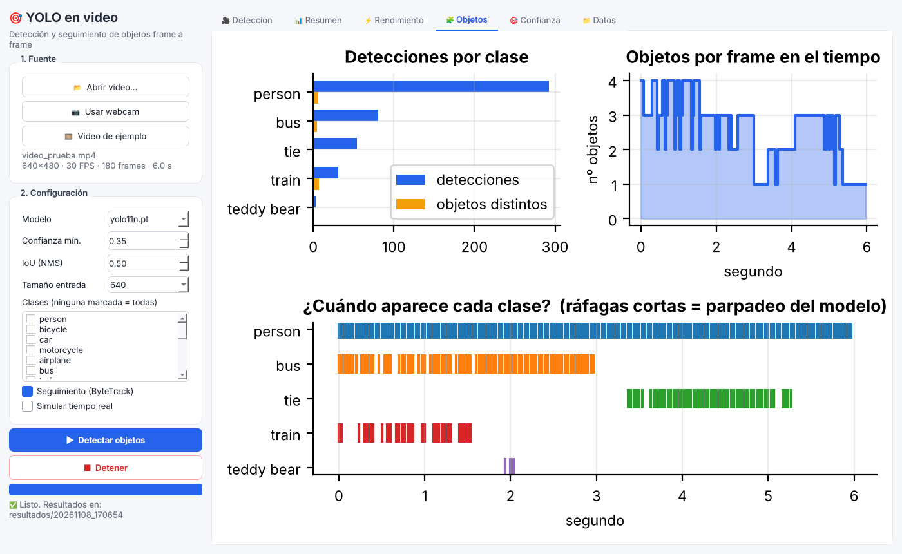
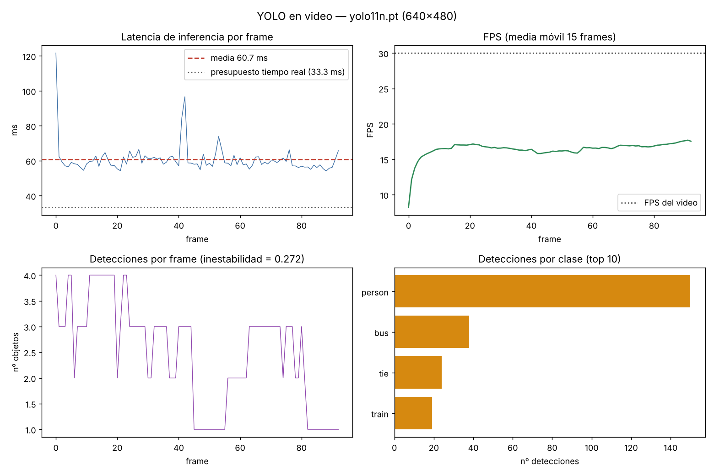

# Ítem 4 — Detección de objetos con YOLO en video / tiempo real

Aplicación que detecta objetos con **YOLO11n** (Ultralytics, preentrenado en COCO, 80 clases) sobre la **webcam** o un **archivo de video**, con seguimiento de objetos (**ByteTrack**) y un modo que **simula tiempo real** descartando frames cuando el modelo no alcanza la velocidad del video.

## Estructura

```
yolo_video/
├── gui.py                 # aplicación de escritorio (PySide6) — principal
├── app.py                 # interfaz web (Streamlit), opcional
├── yolo_video.py          # motor de detección + tracking + métricas (también usable por consola)
├── graficar_metricas.py   # gráficas estáticas a partir del CSV (modo consola)
├── docs/                  # capturas de la interfaz
├── requirements.txt
├── video_prueba.mp4       # video de prueba (paneo de cámara, 180 frames @ 30 fps)
├── res_full/              # ejecución procesando todos los frames
└── res_rt/                # ejecución en simulación de tiempo real
    ├── video_anotado.mp4
    ├── metricas_por_frame.csv
    ├── resumen_metricas.json
    └── graficas_metricas.png
```

## Instalación y uso

```bash
pip install -r requirements.txt
```

### Aplicación de escritorio (ventana) — principal

```bash
python gui.py
```

1. **Fuente**: *Abrir video…*, *Usar webcam* o *Video de ejemplo*.
2. **Configuración**: modelo (yolo11n/yolo11s/yolov8n), confianza mínima, IoU, tamaño de entrada, clases a detectar (ninguna marcada = todas), seguimiento ByteTrack y simulación de tiempo real.
3. **▶ Detectar objetos**: la pestaña *Detección* muestra el video **en vivo** con las cajas, IDs de seguimiento, FPS, latencia y objetos por frame. *■ Detener* corta el proceso (para la webcam, es la forma de terminar).
4. Al terminar se habilitan las pestañas:
   - **Resumen**: 6 indicadores (FPS, latencia, ¿tiempo real?, frames, detecciones, objetos distintos), **datos interesantes** generados automáticamente y el **momento con más objetos**, con botones para reproducir el video anotado y abrir la carpeta de resultados.
   - **Rendimiento**: latencia por frame frente al límite de tiempo real, FPS, distribución y resumen de latencia.
   - **Objetos**: detecciones frente a objetos distintos por clase, objetos en el tiempo y **cuándo aparece cada clase** (muestra el parpadeo del modelo).
   - **Confianza**: distribución, confianza por clase y a lo largo del video.
   - **Datos**: tabla con las métricas de cada frame.

Cada ejecución se guarda en `resultados/AAAAMMDD_HHMMSS/` (video anotado, CSV, JSON y las 3 gráficas en PNG para el informe).





### Interfaz web (opcional)

`streamlit run app.py` abre una versión web con las mismas funciones: subir un video, vista en vivo, métricas y descargas.

### Consola

```bash
# Webcam en tiempo real (q para salir)
python yolo_video.py --source 0 --track

# Video, procesando todos los frames y guardando el video anotado
python yolo_video.py --source video_prueba.mp4 --track --save --out res_full

# Video simulando tiempo real (descarta frames atrasados, como una cámara en vivo)
python yolo_video.py --source video_prueba.mp4 --track --realtime --save --out res_rt

# Gráficas
python graficar_metricas.py res_rt
```

Opciones útiles: `--model yolo11s.pt` (más preciso, más lento), `--conf 0.5`, `--classes 0 2` (solo personas y autos), `--no-show` (sin ventana, para Colab/servidor).

## Cómo funciona

1. **Captura**: OpenCV lee frame a frame desde la webcam o el video.
2. **Inferencia**: YOLO procesa el frame completo en **una sola pasada** (single-stage): divide la imagen en una rejilla y predice cajas + clases directamente, a diferencia de Faster R-CNN, que primero genera propuestas de región (RPN) y luego las clasifica (two-stage).
3. **Post-proceso**: filtro por confianza (`--conf`) y NMS (`--iou`) para eliminar cajas duplicadas.
4. **Seguimiento (ByteTrack)**: asocia las detecciones entre frames y les asigna un ID (`#3 person`), lo que permite contar **objetos distintos** y no solo detecciones.
5. **Simulación de tiempo real (reloj virtual)**: el frame *k* "llega" en *k/fps*. El reloj solo avanza con el **tiempo de detección**; al terminar un frame se toma el último que ya llegó y los intermedios se descartan. Así el % de descarte depende solo del detector (≈ 1 − FPS de inferencia / FPS del video) y no del disco, la interfaz o la decodificación, lo que permite comparar con Faster R-CNN de forma justa.
6. **Visualización ≤ 1280 px**: el modelo recibe el frame original (incluso 4K), pero el dibujo, el video guardado y la vista en vivo se hacen en una versión reducida para no robar CPU a la detección.
7. **Métricas**: se registran por frame y se resumen al final (incluye factor de tiempo real = FPS de inferencia / FPS del video y desglose preproceso / inferencia / postproceso).

## Métricas registradas

| Métrica | Qué mide |
|---|---|
| Latencia (media, mediana, p95) | Tiempo de inferencia por frame en ms |
| FPS de inferencia / FPS efectivo | Frames procesados por segundo (solo modelo / extremo a extremo, incluye lectura y dibujo) |
| ¿Tiempo real? | Si los FPS de inferencia ≥ FPS de la fuente |
| Frames descartados | Frames perdidos en modo `--realtime` |
| Detecciones por frame, confianza media | Cantidad y seguridad de las predicciones |
| Inestabilidad | Cambio medio del nº de detecciones entre frames consecutivos (parpadeo) |
| Objetos únicos por clase | IDs distintos asignados por ByteTrack |

## Resultados (CPU, yolo11n, 640×480, video a 30 fps)

| Métrica | Todos los frames | Simulación tiempo real |
|---|---|---|
| Frames procesados | 180 | 93 |
| Frames descartados | 0 | 87 (48 %) |
| FPS de inferencia | 17.7 | 16.5 |
| FPS efectivo | 16.8 | 15.4 |
| Latencia media | ~57 ms | ~61 ms |
| Confianza media | 0.747 | 0.753 |
| Inestabilidad | 0.274 | 0.272 |
| Buses únicos (ByteTrack) | 5 | 4 |
| Trenes únicos (ByteTrack) | 7 | 4 |



## Hallazgos (aporte al ítem 5)

- **Velocidad vs. tiempo real**: en CPU, yolo11n alcanza ~17 FPS, por debajo de los 30 FPS del video (presupuesto de 33 ms por frame frente a ~57 ms reales). En una cámara en vivo esto significa **perder casi la mitad de los frames**. Con GPU, o con una resolución menor (`--imgsz 320`), se supera el umbral de tiempo real.
- **La primera inferencia es lenta** (~120 ms, carga del modelo): por eso el script hace un *warm-up* y conviene reportar la mediana o el p95 además de la media.
- **Confianza estable con o sin descarte**: la calidad por frame no cambia (0.75 en ambos casos); lo que cambia es la **cobertura temporal**. Con objetos rápidos, los frames descartados pueden hacer que un objeto se cruce sin ser detectado.
- **Inconsistencia temporal (propia del video)**: el mismo bus se clasifica a veces como `bus` y a veces como `train` cuando la cámara se acerca y solo se ve una parte; además, en algunos frames con el bus recortado no se detecta. En imágenes sueltas esto pasa desapercibido; en video aparece como **parpadeo** (inestabilidad ≈ 0.27) y **cambios de ID**: ByteTrack contó 5 "buses" y 7 "trenes" donde físicamente hay un solo vehículo.
- **Implicación para la comparación imagen vs. video**: en imágenes se evalúa con **precisión, recall y mAP** sobre etiquetas reales; en video importan además **FPS, latencia, frames perdidos y estabilidad temporal**. Un modelo con buen mAP en imágenes puede ser inutilizable en video si no llega a tiempo real, y uno rápido puede parpadear entre clases.
- **YOLO vs. Faster R-CNN en video**: por ser de una sola etapa, YOLO es mucho más rápido que Faster R-CNN (que suele ir a ~1–5 FPS en CPU), lo que lo hace la opción práctica para tiempo real; Faster R-CNN tiende a ser algo más preciso en objetos pequeños.

## Limitaciones

- El video de prueba se generó con paneos sobre imágenes de ejemplo de Ultralytics; para el informe final conviene probar también con webcam o un video real (calle, aula).
- No se calcula mAP en video porque requiere anotaciones frame a frame; las métricas de calidad son confianza y estabilidad.
